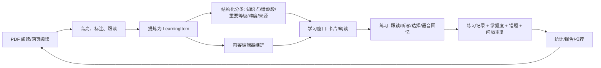

# 学习闭环整合与分类体系优化建议

> **文档范围**：PDF 阅读、句子跟读、高亮/标注、内容编辑、学习窗口（含单词学习）
> **目标**：把目前彼此割裂的功能串成一条「阅读 → 提炼 → 分类 → 练习 → 复习 → 统计 → 回跳原文」的学习闭环
> **日期**：2026-10-22
> **说明**：本文所有结论均基于当前仓库代码事实，关键位置标注了文件与行号，便于直接排期实施。
>
> **v2 修订（同日）**：第十章补充了 9 个架构级优化点，并修正了“写入共享词库”“在未使用的表上加字段”“重复造练习记录”“另造复习优先级”四处实现细节。**实施时以第十章为准。**

---

## 一、结论先行

当前问题不是“功能太少”，而是三件事没有统一：

1. **没有统一的学习对象**：PDF 高亮、标注、跟读录音、AI 闪卡、内容编辑器词条分别落在不同存储里，彼此没有引用关系。
2. **没有统一的写回通道**：跟读、听写、朗读、闪卡的结果没有回写学习项的掌握度、错题、复习计划。
3. **没有结构化的分类维度**：学习项只有「学科 + 子类别」，知识点、适龄段、重要等级、难度、来源都缺失，导致队列、筛选、统计、复习优先级都只能“一锅炖”。

建议按以下顺序推进：

| 阶段 | 主题 | 核心产出 |
|---|---|---|
| **P0** | 打通断点 | “添加到学习”真正可用；高亮/标注一键转学习项；跟读结果落库；PDF 闪卡与学习项统一 |
| **P1** | 分类体系 | 学习项新增知识点/适龄段/重要等级/难度/来源；知识点树与筛选队列 |
| **P2** | 单词跟读与听写 | 复用现有 TTS/录音/评分/语音识别，补齐单词卡练习模式 |
| **P3** | UI 收敛 | 学习窗口“筛选 + 练习 + 来源”三块归位；PDF 侧栏“学习”Tab |
| **P4** | 数据闭环 | 练习记录、统计下钻、复习优先级与重要等级联动 |

---

## 二、现状盘点（代码事实）

### 2.1 五个模块的真实落点

| 模块 | 主要入口 | 数据落点 | 与其他模块的连接现状 |
|---|---|---|---|
| PDF 阅读 | `PdfReaderForm` / `PdfPresenter` | PDF 文件 + `AppData/annotations`、`AppData/highlights` JSON | 有 AI 闪卡 → 间隔重复；有“➕ 添加到学习”按钮但**事件无人订阅** |
| 高亮/标注 | `HighlightService` / `FileAnnotationService` | 按用户、按文件夹/按页的 JSON 文件 | 支持导出 Excel/Markdown；**不产生 LearningItem** |
| 句子跟读 | `SentenceShadowingForm` + `ShadowingStore` | `AppData` 下分句清单 + 录音文件 | 仅窗口内回放与评分；**不写学习状态、不进错题、不进统计** |
| 内容编辑 | `ContentEditorForm` / `ContentEditorPresenter` | 按子类别的 JSON 词库文件（`ContentLoaderService.SaveItems`） | 与学习窗口只共享同一份词库文件，**没有来源、分类、学习状态联动** |
| 学习窗口 | `LearningForm` / `StudyEngine` | JSON 词库 + 学习进度 | 无单词跟读/听写；队列只按学科/子类别，**无知识点/重要等级筛选** |
| 间隔重复 | `SqliteSpacedRepetitionService` | SQLite `ReviewItem` | PDF AI 闪卡只进这里，**不进 LearningItem/学习窗口** |
| 题库/语音回忆 | `QuizEngineService` / `VoiceRecallService` | 内存对象 | **未注册 DI、未接任何 UI** |

### 2.2 七个关键断点

#### 断点 1：PDF“添加到学习”是空转按钮

- `PdfReaderForm` 定义了 `AddToLearningList` 事件（`PdfReaderForm.cs:3642`），按钮点击只做 `AddToLearningList?.Invoke`（`PdfReaderForm.cs:6224-6226`）。
- 全仓库检索该事件只有声明与触发，**没有任何订阅方**，因此点击后不会产生任何学习项。
- `PdfPresenter` 虽持有 `IPdfStudyIntegration` 并暴露 `OnAddWordToLearningList`（`PdfPresenter.cs:51`、`PdfPresenter.cs:1650-1657`），但 `PdfStudyIntegration.AddWordToLearningList`（`PdfStudyIntegration.cs:32`）**没有任何调用点**，整条链路是断的。

#### 断点 2：高亮/标注与学习项没有关联

- `PdfHighlight` 只有路径、页码、归一化坐标、文本、译文、笔记、颜色、时间（`Models/Pdf/PdfHighlight.cs:9-32`），**没有 Tags、没有 LearningItemId、没有 SourceRef**。
- `PdfAnnotationItem` 同样没有学习项引用（`PdfHighlight.cs:92-121`）。
- `HighlightSyncService.AddTagToHighlight` 只修改内存对象的颜色，**没有调用保存**（`HighlightSyncService.cs:206-220`），所谓“标签”并未真正持久化。

#### 断点 3：跟读是孤岛

- 跟读窗口独立运行，使用自己的 `ShadowingStore` 保存分句清单和录音路径（`SentenceShadowingForm.cs:45`、`IPronunciationScorer` 在 `SentenceShadowingForm.cs:96` 解析）。
- `ShadowingManifest`/`ShadowingSentence` 只描述“哪一页、哪一句、文本偏移”（`Models/Shadowing/ShadowingManifest.cs`、`ShadowingSentence.cs`），**没有学习项 Id、没有评分历史、没有掌握度**。
- 跟读完成不会触发 `ItemLearnedEvent`/`ItemWrongEvent`，因此游戏化、统计、复习计划都感知不到。

#### 断点 4：学习项没有分类维度

- 领域模型只有 `Subject`、`SubCategory`、`MainContent`、`Meaning`、`Example`、`Pronunciation`、`CharacterFeatures`、`WordFeatures`、`ExtendedProperties`（`Models/Learning/LearningItem.cs:15-27`）。
- 数据库实体 `LearningItemEntity` 同样只有上述字段 + `Status/ReviewCount/LastReviewedAt`（`Data/Database/Entities.cs:279-314`），**没有知识点、适龄段、重要等级、难度、来源列**。
- 内容编辑器 `DataTable` 只生成模板字段列（`ContentEditorPresenter.cs:167-242`），没有分类维度列。
- 英语单词模板虽然有 `VocabularyLevel`（`Models/Config/SubjectTemplates.json:160`），但它只是展示字段，无法用于筛选、复习加权或统计。

#### 断点 5：单词学习缺跟读/听写入口，但底层能力其实已有

- 学习窗口底部按钮只有：上一个、下一个、认识、不认识、收藏、编辑、统计、挑战、成就、错题、退出（`LearningButtonsView.cs`，`Click +=` 注册处 `275-478`），**没有跟读/听写**。
- 仓库里已存在听写实现：
  - `SpeechService` 提供 `StartDictationSession`、`ScoreDictation`（`WinApp/Services/Learning/SpeechService.cs:183`、`:254`）；
  - `AdvancedSpeechService` 提供 `StartDictationSessionWithScore`（`AdvancedSpeechService.cs:249`）；
  - `VoiceRecallService` 提供语音回忆（`Core/Services/Quiz/VoiceRecallService.cs:33`）；
  - `QuizEngineService` 提供出题与判分（`Core/Services/Quiz/QuizEngineService.cs`）。
- 但 `SpeechService`、`AdvancedSpeechService`、`IVoiceRecallService`、`IQuizEngineService` **均未在 DI 中注册**（`ServiceCollectionExtensions.cs` 内无对应注册），也没有 UI 调用点，属于“有代码、无出口”。

#### 断点 6：PDF 闪卡与学习项是两套数据

- PDF 的 AI 闪卡生成后直接写入间隔重复队列：`ImportFlashcardsToReview` 调用 `CreateNewItem`，并设置 `Category="PDF闪卡"`、`Subject=文档名`（`PdfReaderForm.cs:3136-3168`）。
- 这条路径绕过了 `LearningItem` 与 `StudyEngine`，导致：
  - 学习窗口看不到这些闪卡；
  - 统计口径与普通学习项不一致；
  - 无法回溯到原 PDF 页码与高亮。

#### 断点 7：内容编辑器与学习窗口的“来源”不可追溯

- `LearningItem` 没有 `SourceType` / `SourceRef` 字段。
- 因此无法回答“这个单词来自哪份 PDF 的第几页 / 哪条高亮 / 哪次 AI 生成”，也无法做“回到原文”。

### 2.3 可复用能力清单（不要重复造轮子）

| 能力 | 现有实现 | 建议用途 |
|---|---|---|
| 朗读合成 | `ITTSService` / `KokoroSharpTtsService` | 单词、例句、跟读示范音 |
| 录音 | `IAudioRecorderService`（全局单例，支持 `AudioRecordingScope` 与 `SentenceId`） | 单词跟读、句子跟读、听写口述 |
| 发音评分 | `IPronunciationScorer` / `SystemSpeechPronunciationScorer` / `TextSimilarityScorer` | 跟读参考分；无识别引擎时回退文本相似度 |
| 听写判分 | `SpeechService.DictationScore`、`AdvancedSpeechService` | 听音口述；键盘拼写可直接字符串归一化比较 |
| 语音回忆 | `IVoiceRecallService` | 单词/句子“听音回忆”模式 |
| 出题引擎 | `IQuizEngineService` | 选择题、填空题、判断题批量练习 |
| 间隔重复 | `ISpacedRepetitionService`（SM-2） | 统一复习队列与优先级 |
| 高亮同步 | `IHighlightSyncService` | 高亮导出 Markdown/按标签分类；需补持久化 |
| PDF AI | `IPdfAiService`（问答、总结、闪卡） | 自动分类建议、知识点提炼 |
| 统一入口 | `IUnifiedStudyEntryService` | 已聚合错题/收藏/学习路径，可扩展 PDF 来源 |
| 事件总线 | `IEventBus`（`ItemLearnedEvent`、`ItemWrongEvent`、`ReviewDoneEvent` 等） | 练习结果跨模块联动 |

---

## 三、目标蓝图：一条学习闭环

### 3.1 闭环流程



### 3.2 三个“统一”

1. **统一对象**：所有可学习内容最终都落成 `LearningItem`，并携带 `SourceRef`。
2. **统一能力**：跟读、听写、朗读、语音回忆统一抽成 `IPracticeService`，学习窗口与 PDF 侧栏共用。
3. **统一入口**：`IUnifiedStudyEntryService` 增加 PDF 高亮、PDF 闪卡、跟读句子等来源，学习窗口只认“来源”。

### 3.3 建议的分类维度

| 维度 | 建议字段 | 类型 | 取值建议 | 用途 |
|---|---|---|---|---|
| 知识点 | `KnowledgePointId` / `KnowledgePointPath` | string | 树形路径，如 `英语/词汇/CET4/学术词汇` | 筛选、统计下钻、复习组卷 |
| 适龄段 | `AgeRange` | enum | 通用/学前/小学低/小学高/初中/高中/成人 | 内容推荐、难度兜底 |
| 重要等级 | `Importance` | enum | 拓展(1)/一般(2)/重点(3)/核心(4) | 复习优先级、统计权重、颜色映射 |
| 难度 | `Difficulty` | int | 1–5（可与 `QuestionDifficulty` 对齐） | 自适应练习、错题分析 |
| 来源 | `SourceType` + `SourceRef` | enum + JSON | 手工/PDF 高亮/PDF 标注/跟读/AI 闪卡/导入/游戏 | 回跳原文、来源统计、去重 |
| 自定义 | 保留 `ExtendedProperties` | JSON | 低频、实验性字段 | 不阻塞主流程 |

**为什么不全塞进 `ExtendedProperties`**：知识点、重要等级、适龄段需要参与 SQL/内存筛选、排序、统计聚合与复习加权，必须是可索引的一等字段；`ExtendedProperties` 只适合低频扩展。

### 3.4 高亮颜色 → 重要等级（零额外操作）

| 高亮色 | 建议语义 | 默认重要等级 |
|---|---|---|
| 红 | 核心/考点 | 核心(4) |
| 橙 | 待复习/易错 | 重点(3) |
| 蓝 | 疑问/需讲解 | 重点(3)，并打 `疑问` 标签 |
| 绿 | 笔记/理解 | 一般(2) |
| 粉 | 例子/拓展 | 拓展(1) |
| 黄 | 普通划线 | 一般(2) |

用户可随时在“加入学习”确认框中修改，颜色只作为默认值，避免增加操作负担。

---

## 四、优化建议清单（按优先级）

## P0 · 先打通，不改架构

### P0-1 修复“添加到学习”链路（v2 修订：合并三条导入路径）

**现状**：按钮事件无人订阅，整条链路空转（见断点 1）。仓库里其实已存在三条互不相通的 PDF 导入路径，必须先合并，而不是再加第四条（详见 10.2）。

**做法**：

1. 新增统一入口服务方法（可直接扩展 `IPdfStudyIntegration`，也可新建 `IStudyEntryService`）：
   - 输入：选中文本、当前 PDF 路径、页码、选区矩形、当前学科/子类别；
   - 判断类型：英文单词 → `EnglishWord`；英文整句 → `EnglishSentence`；段落 → `EnglishComprehensive` 或对应学科综合；
   - 写入 `LearningItem`，带 `SourceType=PdfHighlight` 与 `SourceRef`。
2. 在 `PdfReaderForm` 中订阅 `AddToLearningList`，调用上述方法；成功用 Toast 提示，重复内容给出“已存在，是否定位”。
3. `TranslationDialog` 的“📝 加生词本”同样接入同一服务，避免两套逻辑。

**涉及文件**：`PdfReaderForm.cs`、`PdfPresenter.cs`、`PdfStudyIntegration.cs`、`IPdfStudyIntegration.cs`、`TranslationDialog.cs`。

**验收**：

- 选中英文单词点击“添加到学习”，学习窗口对应词库立即出现该词；
- 重复添加不产生重复项，并提示已存在；
- 学习项可回跳 PDF 原页并高亮选区。

### P0-2 高亮/标注一键转学习项

**现状**：高亮只存在 JSON，与学习项无关联（见断点 2）。

**做法**：

1. 高亮列表增加右键菜单与批量操作：`加入学习`、`加入错题`、`标记为重点`。
2. 创建学习项时：
   - `MainContent = highlight.Text`
   - `Meaning = highlight.TranslationText`（为空则用 `Note`）
   - `SourceRef = { pdfPath, pdfHash, pageIndex, highlightId, rect }`
   - `Importance` 按颜色映射（见 3.4）
3. 标注（文字/图形）同样支持“转为学习项”，文本取 `Text`，无文本时取所在页文本摘要。

**涉及文件**：`PdfReaderForm.cs`（高亮列表事件）、`PdfPresenter.cs`、`HighlightService.cs`、`FileAnnotationService.cs`、`LearningItem` 扩展。

**验收**：

- 单条与整页批量均可生成学习项；
- 学习项双击可跳回 PDF 对应页并选中对应高亮；
- 删除高亮不删除学习项，只把来源标记为“原文已删除”。

### P0-3 跟读结果写回学习数据

**现状**：跟读评分与录音只留在跟读窗口（见断点 3）。

**做法**：

1. 新增 `PracticeRecord`（见 5.1），记录：学习项 Id、来源、练习类型、得分、录音路径、用时、时间。
2. 跟读完成时写一条 `PracticeRecord`，并发布 `PracticeCompletedEvent`。
3. **不默认写入错题本**：跟读分低不等于知识错误；只有用户点“加入错题”或听写答错才写 `WrongAnswer`。
4. 学习项详情显示“跟读历史 / 最近得分 / 回放”。

**验收**：

- 跟读一次，统计中练习次数 +1，学习项详情可回放；
- 错题本不被跟读污染；
- 无评分引擎时仍能保存录音与自评结果。

### P0-4 统一 PDF 闪卡与学习项

**现状**：PDF AI 闪卡只进 `ReviewItem`（见断点 6）。

**做法（二选一，建议 A）**：

- **A. 桥接双写**：保留 `ISpacedRepetitionService` 作为复习队列，同时创建 `LearningItem`，`SourceType=PdfAiFlashcard`，并让两者通过 `SourceRef` 关联。学习窗口可见、统计可下钻。
- **B. 单轨改造**：让 `ReviewItem` 增加分类与来源字段，PDF 闪卡与学习项都从 `ReviewItem` 投影。改动更大，不建议首期做。

**验收**：

- PDF 闪卡能在学习窗口按“来源=PDF 闪卡”筛选；
- 删除/编辑闪卡时，学习项与复习队列保持一致；
- 统计中 PDF 来源与普通词库来源可分开查看。

### P0-5 处理“有代码、无出口”的能力

**现状**：`SpeechService`、`AdvancedSpeechService`、`IVoiceRecallService`、`IQuizEngineService` 均未注册 DI（见断点 5）。

**做法**：

- 保留 `AdvancedSpeechService` 作为唯一听写实现，移除或合并重复的 `SpeechService`；
- 注册 `IAdvancedSpeechService`、`IVoiceRecallService`、`IQuizEngineService`；
- 若短期不做 P2，则先删除死代码，避免后续误用两套实现。

**验收**：DI 中每种能力只有一个实现；有单元测试覆盖判分逻辑。

---

## P1 · 分类体系落地

### P1-1 扩展学习项模型、实体与词库 JSON（v2 修订：不要改未使用的表）

**现状修正**：`AppDbContext` 虽然定义了 `DbSet<LearningItemEntity> LearningItems`，但全仓库没有任何 `.LearningItems` 读写调用，实际使用的是 `SpacedRepetitionItems` 与 `LearningItemStates`。在这些“死表”上加列不会产生任何效果（详见 10.3）。

**做法**：

1. `LearningItem` 增加 5 个核心字段（知识点、适龄段、重要等级、内容难度、来源 + SourceRef）。
2. 分类字段落在**实际被读写的位置**：内容侧落 JSON、状态侧落 `SpacedRepetitionItemEntity`、个人内容落新表或激活 `LearningItemEntity`；`AppDbContext.RepairSchema()` 做幂等补列。
3. `ContentLoaderService` 的 JSON 读写保持向后兼容：缺失字段按默认值处理，不批量重写旧文件。
4. `ContentEditorPresenter.ConvertToDataTable` 增加“知识点/适龄段/重要等级/难度/来源”列；仅对全部类别显示通用分类列，学科专属字段仍走模板。

**验收**：

- 旧词库文件可直接加载，新字段有默认值；
- 编辑保存后字段不丢失；
- 编辑器可按新列排序/筛选。

### P1-2 新增知识点树服务

**建议接口**：

```csharp
public interface ILearningTaxonomyService
{
    IReadOnlyList<KnowledgePointNode> GetTree(SubjectType subject);
    KnowledgePointNode Create(string parentId, string name, SubjectType subject, AgeRange ageRange);
    void Rename(string id, string newName);
    void Merge(string sourceId, string targetId);
    void Assign(string itemId, string knowledgePointId);
}
```

**存储建议**：SQLite 表 `KnowledgePoints(Id, ParentId, Name, Subject, AgeRange, SortOrder)`，用户维度隔离；比 JSON 更适合筛选与合并。

**验收**：

- 学习窗口左侧可按知识点树筛选；
- 内容编辑器可选择/新建知识点；
- 合并知识点后，关联学习项自动迁移。

### P1-3 学习队列支持分类筛选

**现状**：`LearningContext` 只有 `UserId/Subject/SubCategory/WordBankFile`，`StudyEngine.BuildStudyItems` 也只按这些维度取数（`StudyEngine.cs:181-217`）。

**做法**：

1. 扩展 `LearningContext`：`KnowledgePointId`、`AgeRange`、`Importance`、`SourceType`。
2. `ContentLoaderService.LoadItems` 与 `StudyEngine` 在加载后按新维度过滤。
3. **进度键必须包含筛选条件哈希**，否则同一词库不同筛选会串进度。
4. 首页/学习窗口显示当前筛选条件，支持“一键清除”。

**验收**：

- 选择“重要等级=核心 + 知识点=四级词汇”后，队列只含符合项；
- 切换筛选后进度独立；
- 清空筛选恢复全量。

### P1-4 AI 自动分类建议（高价值、可后置）

**做法**：

- 复用 `IPdfAiService`/`IAIService`，对新增学习项批量建议知识点、适龄段、重要等级、难度；
- 结果进入“待确认”面板，用户勾选后才写入；
- 按内容哈希缓存，避免重复调用。

**验收**：

- 批量导入 50 条内容可一键生成建议；
- 用户确认前不落库；
- 失败时不影响手工录入。

---

## P2 · 单词跟读与听写

### P2-1 单词卡增加“练习”入口，而不是继续堆主按钮

**现状**：底部已有 11 个按钮（`LearningButtonsView`），继续加按钮会进一步压缩阅读区。

**做法**：

- 在卡片右上角增加 `🎯 练习`，或在底部工具条增加一个“练习”分组；
- 练习面板提供 4 个模式：`跟读`、`听写`、`选择`、`语音回忆`；
- 仅对 `EnglishWord`、`EnglishPhrase`、`EnglishSentence` 显示跟读/听写；其他类别只显示朗读与选择。

**验收**：单词类内容可一键进入跟读/听写；非语言类不出现不适用入口。

### P2-2 单词跟读（复用现有能力）

**流程**：

1. `ITTSService` 播放单词与例句示范音；
2. `IAudioRecorderService` 录音（`Scope=SentenceShadowing` 或新增 `WordShadowing`，带 `SentenceId=学习项Id`）；
3. `IPronunciationScorer` 评分，回显“参考分 XX / 100”；
4. 支持“我的录音 vs 示范音”对比回放；
5. 无语音识别引擎时降级为“录音回放 + 自评（认识/模糊/不认识）”。

**注意**：

- 评分文案必须是“参考分”，不要表述为“发音准确率”（与现有跟读设计保持一致）；
- 录音列表必须按 `Scope` 过滤，避免污染 PDF 整页录音与句子跟读列表。

**验收**：单词卡可跟读、可回放、可保存记录；无引擎时功能不崩。

### P2-3 单词听写（两种模式）

| 模式 | 流程 | 优点 | 适用 |
|---|---|---|---|
| 听音拼写 | TTS 读单词 → 键盘输入 → 归一化比较（大小写/空格/标点） | 稳定、无需识别引擎 | 默认模式 |
| 听音口述 | TTS 读单词 → 语音识别 → `DictationScore` | 练口语与拼写 | 有识别引擎时 |

**规则**：

- 可设置“重听次数”（默认 2 次），超出后显示提示；
- 答错写入错题本，并发布 `ItemWrongEvent`；
- 答对按质量分推进 `LearningStatus` 与 SM-2；
- 支持“例句听写”（听整句写整句），用于 `EnglishSentence`。

**验收**：两种模式均可完成一轮 10 词听写并给出正确率；错题进入错题本；结果进入统计。

### P2-4 统一练习记录与事件（v2 修订：复用 AudioRecording）

```csharp
public enum PracticeType { Shadowing, Dictation, VoiceRecall, Choice, Reading }

public sealed class PracticeRecord
{
    public string Id { get; init; } = Guid.NewGuid().ToString();
    public string UserId { get; init; } = string.Empty;
    public string? LearningItemId { get; init; }
    public PracticeType Type { get; init; }
    public StudySourceType SourceType { get; init; }
    public double Score { get; init; }
    public double MaxScore { get; init; }
    public int DurationMs { get; init; }
    public string? RecordingPath { get; init; }
    public string MetaJson { get; init; } = "{}";
    public DateTime CreatedAt { get; init; } = DateTime.Now;
}
```

- 通过 `IPracticeRecordService.RecordAsync` 统一写入；
- 发布 `PracticeCompletedEvent`，由统计、游戏化、推荐服务订阅；
- 学习窗口只依赖该接口，不直接调用录音/评分实现。

**验收**：四种练习都产生统一记录；统计可按练习类型、来源、知识点下钻。

### P2-5 录音与临时文件治理

- 单词跟读录音进入用户录音目录，路径写入 `PracticeRecord`；
- TTS 临时文件写入 `Path.GetTempPath()`，禁止落到 TTS 缓存目录；
- 清理策略：非收藏/非导出的练习录音按保留天数清理，数据库只保留路径与得分。

---

## P3 · UI 收敛

### P3-1 学习窗口：筛选条 + 可折叠练习/来源面板

**建议最小改动**（不推翻现有五视图结构）：

- 顶部增加一行筛选条：知识点、适龄段、重要等级、来源；
- 右侧增加可折叠面板：`来源与原文`（PDF 页码、高亮文本、回跳按钮）与 `练习`（跟读/听写/选择）；
- 默认折叠，保证卡片区仍是视觉主体。

**验收**：默认进入仍是沉浸式卡片；打开面板后不遮挡“认识/不认识”主按钮；深色模式配色一致。

### P3-2 PDF 侧栏增加“学习”Tab

- 汇总本页：高亮数量、已转学习项数量、闪卡数量、跟读句数；
- 提供“把本页高亮全部加入学习”“生成本页闪卡”“开始本页跟读”；
- 每条学习项显示当前状态（新/学习中/已掌握/错题），点击可回跳。

**验收**：从 PDF 到学习项不超过 2 次点击；学习项状态与学习窗口一致。

### P3-3 内容编辑器增加“试学/预览”

- 选中行 → “试学”：用 `LearningCard` 渲染该条内容，验证字段、模板、发音是否正常；
- 显示分类完整度提示（缺知识点/适龄段/重要等级时标黄）；
- 保存前可校验重复与必填。

**验收**：编辑内容无需切换到学习窗口即可验证展示效果。

---

## P4 · 数据与复习闭环

### P4-1 统计维度扩展

在现有 `ILearningStatsAggregator` 基础上增加维度：

- 按知识点：掌握率、错题率、平均练习分；
- 按适龄段：内容覆盖与掌握分布；
- 按重要等级：核心项掌握率（优先关注的 KPI）；
- 按来源：PDF 高亮/PDF 闪卡/词库/手动录入的学习投入与产出。

**验收**：统计页可下钻到知识点，并导出对应明细。

### P4-2 复习优先级与重要等级联动（v2 修订：不要与现有 FSRS 字段打架）

建议使用可解释的规则，而不是黑盒模型：

```text
PriorityScore =
    ImportanceWeight(重要等级)        // 核心 4 / 重点 3 / 一般 2 / 拓展 1
  × (1 + WrongRate)                  // 错误率越高越优先
  × (1 + SourceBoost)                // PDF 原文来源略微加权
  × DueUrgency                       // 到期紧迫度
```

- `ReviewItem` 增加 `Importance`、`KnowledgePointId`、`SourceRef`；
- 到期队列按 `PriorityScore` 排序；
- 核心项答错时降低 SM-2 质量分，缩短间隔。

**验收**：核心项在同等到期日下优先出现；统计能解释“为什么推荐这一项”。

### P4-3 闭环回流

- 学习窗口完成练习后，可“回到原文”定位到 PDF 页码/高亮；
- PDF 侧栏显示该项最近一次练习时间与得分；
- 内容编辑器显示该项被学习/练习次数，帮助判断内容质量。

---

## 五、关键实现草案

### 5.1 模型扩展

```csharp
public enum AgeRange
{
    All = 0,
    Preschool = 1,
    PrimaryLow = 2,
    PrimaryHigh = 3,
    JuniorHigh = 4,
    SeniorHigh = 5,
    Adult = 6
}

public enum ImportanceLevel
{
    Extension = 1,
    Normal = 2,
    Key = 3,
    Core = 4
}

public enum StudyContentSource
{
    Manual = 0,
    PdfHighlight = 1,
    PdfAnnotation = 2,
    PdfShadowing = 3,
    PdfAiFlashcard = 4,
    Import = 5,
    Game = 6
}

public sealed class LearningSourceRef
{
    public string? PdfPath { get; set; }
    public string? PdfHash { get; set; }
    public int PageIndex { get; set; } = -1;
    public string? HighlightId { get; set; }
    public string? AnnotationId { get; set; }
    public string? SentenceId { get; set; }
    public float NormX { get; set; }
    public float NormY { get; set; }
    public float NormWidth { get; set; }
    public float NormHeight { get; set; }
}
```

`LearningItem` 新增：

```csharp
public string? KnowledgePointId { get; set; }
public string KnowledgePointPath { get; set; } = string.Empty;
public AgeRange AgeRange { get; set; } = AgeRange.All;
public ImportanceLevel Importance { get; set; } = ImportanceLevel.Normal;
public int Difficulty { get; set; } = 3;
public StudyContentSource SourceType { get; set; } = StudyContentSource.Manual;
public LearningSourceRef? SourceRef { get; set; }
```

`LearningItemEntity` 对应增加列（可空或带默认值），`SourceRefJson` 存 JSON；`RepairSchema` 做幂等补列。

### 5.2 迁移与兼容策略

1. **JSON 词库**：读取时缺字段填默认值；不在启动时全量重写，只在用户编辑保存时写回。
2. **SQLite**：按现有 `MigrationCheckpointEntity` 机制增加 `Taxonomy` 步骤，支持中断续跑。
3. **旧数据回填**：
   - 默认 `AgeRange=All`、`Importance=Normal`、`Difficulty=3`、`SourceType=Manual`；
   - PDF 来源的高亮/闪卡在首次打开时按需回填，不做全库扫描。
4. **回滚**：新增列可空/有默认值，旧版本代码忽略即可；不删除旧字段。

### 5.3 统一入口与练习服务

```csharp
public interface IStudyEntryService
{
    Task<LearningItem?> AddFromTextAsync(AddStudyTextRequest request, CancellationToken ct = default);
    Task<int> AddFromHighlightsAsync(string pdfPath, IEnumerable<string> highlightIds, CancellationToken ct = default);
    Task<int> AddFromShadowingAsync(string pdfPath, int pageIndex, IEnumerable<string> sentenceIds, CancellationToken ct = default);
}

public interface IPracticeService
{
    Task<PracticeSession> StartAsync(string learningItemId, PracticeType type, CancellationToken ct = default);
    Task<PracticeRecord> SubmitAsync(PracticeSession session, PracticeAnswer answer, CancellationToken ct = default);
}
```

**事件契约**：

| 事件 | 触发方 | 消费方 |
|---|---|---|
| `LearningItemCreatedEvent` | `IStudyEntryService` | 学习窗口刷新、统计缓存失效 |
| `PracticeCompletedEvent` | `IPracticeService` | 统计、游戏化、推荐、错题 |
| `TaxonomyChangedEvent` | `ILearningTaxonomyService` | 学习队列、统计、内容编辑器 |

### 5.4 单词听写交互流程

```text
进入练习
  → 选择模式（听音拼写 / 听音口述）
  → TTS 播放单词（可重听 N 次，不显示拼写）
  → 用户输入或口述
  → 归一化比较 / 语音识别
  → 正确：显示释义与例句，推进掌握度，记录 PracticeRecord
  → 错误：显示正确答案与差异，写入错题，记录 PracticeRecord
  → 下一词 / 结束并给出本轮正确率
```

### 5.5 进度隔离

`ProgressManager` 的进度键建议从：

```text
{userId}:{subject}:{subCategory}:{wordBank}
```

扩展为：

```text
{userId}:{subject}:{subCategory}:{wordBank}:{filterHash}
```

`filterHash` 由知识点、适龄段、重要等级、来源组合计算，避免筛选切换时进度串线。

---

## 六、实施路线与验收

| 阶段 | 内容 | 关键文件 | 验收标准 |
|---|---|---|---|
| **P0-1** | 修复“添加到学习” | `PdfReaderForm.cs`、`PdfPresenter.cs`、`PdfStudyIntegration.cs` | 按钮可用、可回跳、可去重 |
| **P0-2** | 高亮/标注转学习项 | `HighlightService.cs`、`FileAnnotationService.cs`、`LearningItem.cs` | 单条/批量可用，来源可追溯 |
| **P0-3** | 跟读结果落库 | `SentenceShadowingForm.cs`、`PracticeRecord` | 有练习记录与回放，不污染错题 |
| **P0-4** | PDF 闪卡统一 | `PdfReaderForm.cs:3136`、`ISpacedRepetitionService` | 学习窗口可见、统计可分流 |
| **P0-5** | 清理/接线语音能力 | `ServiceCollectionExtensions.cs`、`SpeechService.cs` | 单一实现、可测试 |
| **P1-1** | 模型与实体扩展 | `LearningItem.cs`、`Entities.cs`、`AppDbContext.cs`、`ContentEditorPresenter.cs` | 旧数据兼容、编辑器可维护 |
| **P1-2** | 知识点树 | 新增 `ILearningTaxonomyService` + 表 | 可筛选、可合并 |
| **P1-3** | 队列筛选 | `LearningContext`、`ContentLoaderService.cs`、`StudyEngine.cs` | 筛选正确、进度隔离 |
| **P2-1/2/3** | 单词跟读与听写 | `LearningCard`、`LearningButtonsView.cs`、`IPracticeService` | 两种练习模式可用、结果落库 |
| **P3-1/2/3** | UI 收敛 | `LearningForm`、`PdfReaderForm`、`ContentEditorForm` | 入口不超过 2 次点击 |
| **P4** | 统计与复习联动 | `LearningStatsAggregator`、`SqliteSpacedRepetitionService` | 可按知识点下钻、核心项优先 |

**依赖关系**：

- P0 全部可并行；
- P1-1 是 P1-2/P1-3/P2/P4 的前置；
- P2 依赖 P0-3 的 `PracticeRecord` 与 P0-5 的语音能力接线；
- P3 可在 P1/P2 任意阶段插入，但建议在 P1-3 之后做筛选条。

---

## 七、风险与回归清单

1. **JSON 向后兼容**：新增字段必须可缺省；禁止启动时全量重写用户词库。
2. **进度串线**：新增筛选维度后，进度键必须包含筛选哈希，否则不同筛选共用进度。
3. **录音污染**：单词跟读必须带独立 `Scope`，现有整页录音/句子跟读列表按 `Scope` 过滤。
4. **错题污染**：跟读低分默认不进错题；只有听写错误或用户主动标记才进。
5. **两套复习数据**：P0-4 若选择双写，必须定义清楚“谁是主数据”，避免编辑不同步。
6. **DI 重复实现**：`SpeechService` 与 `AdvancedSpeechService` 只能保留一个，避免调用方选错。
7. **语音识别可用性**：Windows SpeechRecognition 语言包缺失时，跟读/听写需降级，不得崩溃。
8. **线程与 UI**：录音完成事件、评分回调必须回到 UI 线程；跨线程 `Invoke` 前检查句柄。
9. **用户隔离**：所有新表/文件路径必须使用 `IUserSessionService.GetCurrentUserId()`，禁止 `Environment.UserName`。
10. **删除语义**：删除高亮/标注不级联删除学习项，只标记来源失效；删除学习项保留原始高亮与录音。
11. **性能**：高亮批量转学习项需分批写入（参考现有批量 500 条一批），避免 SQLite 参数上限。
12. **统计口径**：PDF 来源与普通词库来源必须可区分，否则新旧统计无法对比。

---

## 八、待决策问题

| # | 问题 | 建议 |
|---|---|---|
| 1 | 分类字段存 DB 列还是 `ExtendedProperties`？ | 5 个核心维度存列，其余进 `ExtendedProperties` |
| 2 | 知识点树是全局共享还是用户私有？ | 首期用户私有，后续支持“全局模板 + 用户副本” |
| 3 | 跟读评分是否计入掌握度？ | 默认只进练习统计；用户可开启“跟读计入掌握度” |
| 4 | PDF 闪卡与学习项双轨还是单轨？ | 首期双写桥接（方案 A），稳定后再评估单轨 |
| 5 | 听写默认用键盘还是语音？ | 默认键盘拼写，语音口述作为可选模式 |
| 6 | 一个学习项是否允许多个知识点？ | 允许，建议多对多标签；`KnowledgePointPath` 仅存主路径 |
| 7 | 适龄段是否参与队列过滤？ | 参与筛选，但不作为默认硬过滤，避免误伤成人/混合内容 |

---

## 九、最小可行闭环（MVP）

如果只做最小闭环，建议只做这 6 件事（**P0-0 为前置**）：

0. **P0-0** 统一学习项身份（`ItemKey` + `CanonicalKey`），停止用 `MainContent` 当主键；
1. **P0-1** 修复“添加到学习”，让 PDF 内容能进入学习窗口；
2. **P0-2** 高亮一键转学习项，带页码与来源；
3. **P1-1** 给学习项加“重要等级 + 知识点”两个字段，先跑通筛选；
4. **P2-1/2** 单词卡加“跟读”，复用现有 TTS + 录音 + 评分；
5. **P4-1** 统计增加“按来源/按重要等级”两个维度。

完成这 6 项后，用户就能感知到：**从 PDF 划线 → 进入学习 → 跟读练习 → 统计可见**，闭环已经成立；后续再补听写、知识点树与 UI 收敛。

---

## 十、方案二次评审与 v2 修订

> 本章回答“上述方案还有没有优化空间”。结论：**有，而且最关键的不是再加功能，而是先补 5 个地基。** 如果跳过这些地基，P1 的分类和 P2 的练习都会建立在不稳定的身份与存储之上。

### 10.0 原方案需要修正的 5 处

| 原方案 | 风险 | v2 修正 |
|---|---|---|
| P0-1 把 PDF 内容写入 `LearningItem` / 共享词库 | 多用户互相覆盖；共享 JSON 写冲突；系统词库被个人数据污染 | 写入**用户个人库**；系统词库保持只读 |
| P1-1 在 `LearningItemEntity` 上加分类列 | 该表当前没有任何读写调用，加列无效 | 在实际活跃的 JSON、`SpacedRepetitionItemEntity`、个人内容表上加 |
| P2-4 新建 `PracticeRecord` 并复制录音路径 | 与现有 `AudioRecording` 重复，产生第四套录音元数据 | `PracticeRecord` 只引用 `AudioRecordingId` |
| P4-2 新建独立 `PriorityScore` 公式 | 与现有 FSRS/SM-2 字段重复计算难度，可能饿死低重要度内容 | 重要度进入目标留存率/每日配额/同到期排序，不另造算法 |
| P0-4 PDF 闪卡“双写” | JSON 与 SQLite 跨存储无法事务一致，编辑后易分叉 | 明确单一主数据，另一侧做投影；或同库事务内写 |

### 10.1 最高优先级：先统一“身份”，再谈分类与练习

**代码事实**：

- `LearningItem` 本身有稳定 `Id`（`LearningItem.cs:11`，`Create` 时生成 Guid，`:119`）。
- 但学习流程发布事件时把内容当主键：`ItemLearnedEvent.ItemId = currentItem.GetMainContent()`（`LearningFlowHandler.cs:345`），`ItemWrongEvent` 同样（`:424`）。
- 间隔重复同步按内容字符串匹配：`SyncToSpacedRepetition` 用 `i.Content.Trim() == content.Trim()` 查找既有项（`LearningFlowHandler.cs:357-366`）。
- 学习状态表 `LearningItemStateEntity` 的复合键也是 `CategoryName + Content`（`Entities.cs:261-273`）。

**后果**（都会在 P1/P2 之后集中爆发）：

1. 用户改一个词的拼写或释义，历史复习记录、错题、练习成绩全部“丢失”（实际是挂在旧字符串上）。
2. 同一个词出现在两个知识点/两份 PDF 中，会被错误合并成一条，或产生两条互不相关的记录。
3. `PracticeRecord.ItemId`、`SourceRef.LearningItemId` 无法与既有复习数据对齐。
4. 删除后重新导入同名词，会“继承”旧的掌握度。

**v2 方案（P0-0，所有后续工作的前置）**：

```csharp
// 稳定身份：创建后不可变
public string ItemKey { get; set; }        // = LearningItem.Id（GUID）

// 去重键：可重建、可迁移，仅用于判重
public string CanonicalKey { get; set; }   // subject|subcategory|Normalize(MainContent)
```

迁移步骤：

1. 为缺少 `Id` 的旧词库项补 GUID，并写回所在 JSON（仅一次，带备份）。
2. 事件、状态、复习、练习记录统一改为引用 `ItemKey`；`MainContent` 只用于展示与搜索。
3. 用 `CanonicalKey` 把现有 `ReviewItem.Content` 回填到 `ItemKey`；冲突项生成“歧义报告”，人工确认后再合并。
4. 删除词库项时改为软删除（`IsDeleted`），保留历史状态；重新导入同 `CanonicalKey` 时恢复原 `ItemKey`。

**验收**：

- 修改学习项内容后，复习历史、错题、练习记录仍然关联；
- 同名词跨来源可显式选择“合并”或“保留为两条”；
- 删除后重新导入，不会意外继承掌握度（除非用户选择恢复）。

### 10.2 三条 PDF 导入路径合并为一条，且不要写共享词库

**代码事实**：仓库里已经有三条“PDF → 学习”的路径，全部不通或半通：

| 路径 | 状态 | 证据 |
|---|---|---|
| `PdfReaderForm.AddToLearningList` 事件 | 无订阅方，按钮空转 | `PdfReaderForm.cs:3642`、`:6224-6226` |
| `IPdfStudyIntegration.AddWordToLearningList` | 无调用方 | `PdfStudyIntegration.cs:32` |
| `IPdfContentLinkService.ExportToLearningLibrary` | 已注册 DI，但无 UI 调用；写入 `UserContent`，而 `UserContent` 只有保存、没有加载，`StudyEngine` 也不读 | `ServiceCollectionExtensions.cs:147`、`PdfContentLinkService.cs:231-268`、`ContentLoaderService.cs:312-329` |

同时，`ContentLoaderService.SaveItems` 写的是**按子类别共享的 JSON 词库**（`ContentLoaderService.cs:196-201`），不是按用户隔离的存储。

**v2 方案**：

1. 只保留一个入口 `IStudyEntryService`，另外两条路径删除或改为内部实现，禁止再出现第四条。
2. 明确“三类数据、三种归属”：

| 数据类型 | 归属 | 存储 | 是否可写 |
|---|---|---|---|
| 系统词库/内置内容 | 产品 | 按子类别 JSON | 只读（升级时替换） |
| 用户个人内容（PDF 导入、AI 闪卡、手工新增） | 用户 | SQLite 个人内容表或 `UserContent` + 加载器 | 可写 |
| 学习状态/练习记录 | 用户 | SQLite | 可写 |

3. `StudyEngine` 的取数改为“系统词库 + 当前用户个人内容”的并集，而不是只读单个 JSON。
4. `UserContent` 要么补 `LoadUserContents(userId)` 并接入 `StudyEngine`，要么直接废弃，避免继续做一个“只写不读”的黑洞。

**验收**：

- 两个用户从同一 PDF 导入同名内容，互不覆盖；
- 导入后系统词库 JSON 的修改时间不变；
- 导入项能在学习窗口被筛选、学习、练习；
- 全仓库只有一条 PDF→学习 的写路径。

### 10.3 不要在“死表”上做扩展

**代码事实**：

- `AppDbContext` 定义了 `DbSet<LearningItemEntity> LearningItems`（`AppDbContext.cs:24`），`DbModelConverter` 也有转换方法；
- 但全仓库没有任何 `.LearningItems` 读写调用；
- 实际在用：`SpacedRepetitionItems`（复习状态）、`LearningItemStates`（学习状态）、`ReviewLogs`（复习日志）。

**v2 方案**：

1. 先做一次“表使用审计”，把表分为活跃/未使用/历史三类。
2. 若决定用 `LearningItemEntity` 承载“用户个人内容”，就把它真正接上读写与迁移；否则不要在这个表上加任何字段。
3. 分类字段落在真正被读写的位置：
   - 内容元数据：词库 JSON；
   - 用户状态/复习：`SpacedRepetitionItemEntity`；
   - 个人内容：新表或激活后的 `LearningItemEntity`。
4. 删除或标注未使用的 `DbSet`，避免下一位开发者重复踩坑。

**验收**：每个新增列都能指出“谁写入、谁读取、哪个迁移脚本创建”，并有集成测试覆盖。

### 10.4 分类模型收敛为“标签 + 主路径”

原方案的“单棵知识点树 + 单值适龄段 + 单值重要等级”有三个隐患：

1. **一个学习项往往属于多个知识点**（例如“abandon”同时属于“四级词汇/动词/情感类”）。单值字段会强迫用户二选一。
2. **适龄段是一个区间而不是单点**（“小学高年级到初中”很常见）。
3. **重要等级有“内容默认值”和“用户自定义”两种语义**，混在一个字段里会导致用户改了就丢失内容原意。

**v2 建议**：

```csharp
public List<string> KnowledgeTagIds { get; set; } = new();   // 多对多
public string? PrimaryKnowledgePath { get; set; }            // 仅用于默认展示/统计归类

public int? AgeRangeMin { get; set; }                        // 3 = 小学低年级
public int? AgeRangeMax { get; set; }                        // 6 = 初中
// 或 List<AgeRange> AgeTags，二者选一，不要同时存在

public ImportanceLevel Importance { get; set; } = ImportanceLevel.Normal;  // 内容默认
public ImportanceLevel? UserImportance { get; set; }                        // 用户覆盖，null 表示未覆盖
```

另外两点：

- **必须补 `LearnerProfile`（年龄/年级/考试目标）**，否则“适龄段筛选”没有参照系，只是装饰。
- **不要新增第二个 `Difficulty`**：`ReviewItem` 已经有 FSRS 的 `Difficulty`（`Entities.cs:200`）。如果确实需要“内容难度”，命名为 `ContentDifficulty`，并明确它不参与 FSRS 计算。
- 知识点首期限制 3 层、允许“未分类”、导入时自动建叶子节点、提供合并工具，避免树无限膨胀。

### 10.5 复习：不要另造优先级公式与现有 FSRS 字段打架

`ReviewItem` 已有 `EFactor / Stability / Difficulty / Retrievability / AlgorithmType / LearningStage`（`ReviewItem` 与 `SpacedRepetitionItemEntity` 同构，`Entities.cs:186-219`），说明系统已经在走 FSRS/SM-2 混合路线。

原方案的 `PriorityScore` 会带来两个问题：

1. **难度被重复计算**：内容难度、FSRS Difficulty、重要等级同时进入排序，权重无法解释。
2. **低重要度内容被饿死**：长期只推核心项，拓展内容永远不到期，违反“覆盖优先”。

**v2 建议**：

- 重要等级不直接乘进排序分，而是影响：
  - 目标留存率（核心项要求更高留存）；
  - 每日新卡/复习配额（核心项占比上限，例如 60%，其余留给一般/拓展）；
  - 同到期日内的二级排序（tie-breaker）。
- 保留 `ReviewItem.Difficulty/Stability` 的算法语义，不被 UI 字段污染。
- 每次推荐记录“推荐原因”（到期/核心/错题/新卡），便于解释与调参。
- 绝不用跟读/听写的 ASR 分数直接改 SM-2 质量分；ASR 只进练习统计。

### 10.6 练习记录复用 `AudioRecording`，避免第四套录音元数据

系统已有 `AudioRecording`（含 `Scope`、`SentenceId`、文件路径），而原方案的 `PracticeRecord` 又带 `RecordingPath`，会产生两份可能不一致的录音元数据。

**v2 建议**：

```csharp
public sealed class PracticeRecord
{
    public string Id { get; init; } = Guid.NewGuid().ToString(); // 幂等键
    public string UserId { get; init; } = string.Empty;
    public string ItemKey { get; init; } = string.Empty;        // 不是 MainContent
    public PracticeType Type { get; init; }
    public double Score { get; init; }
    public double MaxScore { get; init; }
    public int DurationMs { get; init; }
    public string? AudioRecordingId { get; init; }              // 只引用，不复制路径
    public string MetaJson { get; init; } = "{}";
    public DateTime CreatedAt { get; init; } = DateTime.Now;
}
```

配套约束：

- **幂等**：以 `PracticeRecord.Id` 或 `(ItemKey, Type, AttemptNo)` 去重，事件重放不重复计数。
- **保留策略**：明细保留 N 天，之后按天聚合到 `PracticeDailySummary`；录音按“收藏/错题/最近 N 天”保留。
- **索引**：`(UserId, ItemKey, CreatedAt)`、`(UserId, Type, CreatedAt)`。
- **掌握度定义**：ASR 分数不是掌握度；掌握度只由“间隔后的回忆正确性”决定。建议在文档中固定一张“掌握度判定表”，避免各模块各自解释。

### 10.7 PDF 锚点要能“活得久”

原方案只存 `pdfPath + pageIndex + rect`，在实际使用中会失效：

- 文件被移动/重命名 → 路径失效；
- PDF 被替换成新版 → 页码漂移；
- 扫描版 PDF → 高亮没有文本，转学习项为空；
- 页面旋转/缩放 → 归一化坐标解释不一致。

**v2 建议**：

1. 文档身份用 `contentHash + size + pageCount`，维护 `DocumentRegistry(hash → 当前路径)`；路径变化时自动 rebase。
2. `SourceRef` 同时存三种锚点，按优先级回退：`quote selector（前缀/后缀/文本）` → `归一化矩形 + 旋转角` → `页码`。
3. 扫描页高亮文本为空时，先尝试 OCR；OCR 不可用则标记“来源文本不可用”，但学习项仍保留，允许用户手工补全。
4. `SourceRef` 带 `schemaVersion`，加载时校验并容错；缺失字段降级而不是抛异常。
5. PDF 换版后，先做文本匹配，再退回页码，避免把旧标注错位到新页。

### 10.8 交互、输入法与可访问性

听写是键盘密集型功能，WinForms 下有几个必须提前设计的点：

1. **IME 组合输入**：中文/日文输入法组合期间不能触发提交；用 `KeyDown` 判断 `e.KeyCode == Enter` 时同时检查 `ImeCompositionMode`/组合状态。
2. **焦点管理**：进入练习自动聚焦输入框；提交后焦点保持在输入框；Esc 退出前确认；重听快捷键（如 `Ctrl+R`）不与输入冲突。
3. **重试可见**：显示“剩余重听次数”，答错后不允许无限重听刷答案。
4. **可访问性**：按钮提供 `AccessibleName`；重要等级不能只用颜色区分（同时用文字/图标）；支持高对比度与 125%/150% DPI。
5. **入口收敛**：不要给底部再加第 12 个按钮；用“练习”拆分按钮或右侧可折叠面板，主操作（认识/不认识）位置保持不变。

### 10.9 交付方式：垂直切片 + 指标 + Kill criteria

原方案是横向分阶段（先 P0 再 P1…），容易出现“做了很多底层，用户无感知”。建议改为**一个垂直切片**先跑通：

```text
PDF 高亮（带来源）
  → 写入用户个人库（ItemKey + CanonicalKey + 标签）
  → 学习窗口按标签筛选
  → 单词跟读 / 听写
  → 练习记录 + 统计
  → 回跳 PDF 原页
```

配套指标（上线前先埋点）：

| 指标 | 说明 | 目标方向 |
|---|---|---|
| 高亮转学习项转化率 | 高亮数中被加入学习的比例 | 上升 |
| 练习完成率 | 进入练习后完成一轮的比例 | 上升 |
| 7 日回访率 | 练习后 7 天内再次学习 | 上升 |
| 来源孤儿率 | `SourceRef` 找不到原文的学习项占比 | 下降 |
| 重复项率 | 同 `CanonicalKey` 的重复学习项占比 | 下降 |
| 崩溃/降级率 | 无语音包、DB 锁、录音失败等降级次数 | 下降 |

Kill criteria（避免“做了但没用”）：

- 若 ASR 单词评分与人工判断一致率低，默认关闭评分，只保留录音回放与自评；
- 若 AI 自动分类的人工采纳率低，退回手工标签，不强行上线；
- 若高亮转学习项转化率长期极低，优先检查入口位置与操作步数，而不是继续加分类字段。

### 10.10 测试与数据修复

新增“身份 + 分类 + 练习”后，最容易出问题的是历史数据。建议把测试与修复当成交付物的一部分：

**单元测试**

- `CanonicalKey` 归一化：大小写、全半角、首尾空格、标点、重复空格；
- 去重与合并：同词跨来源、同词跨知识点；
- 分类合并：知识点合并后关联迁移；
- 进度键：筛选切换不串进度；
- 听写判分：大小写、连字符、英式/美式拼写、空输入。

**集成测试**

- 多用户隔离：两个用户同时导入同一 PDF；
- PDF 移动/重命名/换版后的来源回跳；
- 扫描版 PDF（无文本层）转学习项；
- 无 Windows Speech 语言包时的降级；
- SQLite busy/locked 下的重试与不丢数据；
- 中文 IME 组合输入下的听写提交。

**数据修复工具**

- 迁移 dry-run：先输出“将补 Id 多少条、将合并多少条、冲突多少条”，确认后再写；
- 孤儿来源报告：`SourceRef` 无法解析的学习项清单；
- 重复项报告：同 `CanonicalKey` 分组；
- 迁移检查点：继续复用现有 `MigrationCheckpointEntity`，支持中断续跑。

### 10.11 修订后的实施顺序

| 顺序 | 事项 | 前置 | 说明 |
|---|---|---|---|
| **0** | `ItemKey` + `CanonicalKey` 身份统一 | 无 | 所有后续工作的地基 |
| **1** | 合并三条 PDF 导入路径 → `IStudyEntryService` | 0 | 只保留一条写路径 |
| **2** | 用户个人库（系统词库只读） | 0、1 | 解决多用户与写冲突 |
| **3** | 高亮/标注 → 学习项 + `SourceRef` | 1、2 | 打通 PDF → 学习 |
| **4** | 练习记录（引用 `AudioRecording`） | 0 | 跟读/听写共用账本 |
| **5** | 标签/适龄段/重要等级 + `LearnerProfile` | 0、3 | 分类与筛选 |
| **6** | 单词跟读/听写 UI | 4、5 | 复用现有 TTS/录音/评分 |
| **7** | 统计与复习加权 | 4、5 | 重要度进入配额与排序 |
| **8** | UI 收敛与可访问性 | 3、6 | 入口不超过 2 次点击 |

**一句话总结 v2**：原方案是“加分类、加练习、加面板”；v2 是“先统一身份与存储，再把分类和练习作为同一套数据的不同视图”。前者会越做越复杂，后者才能越做越简单。
